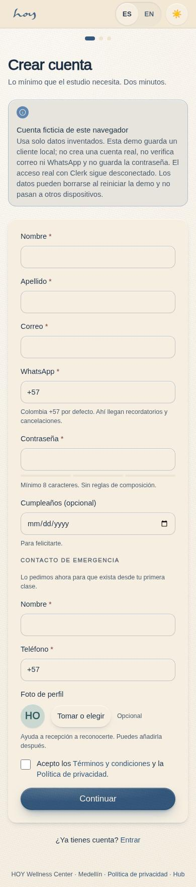
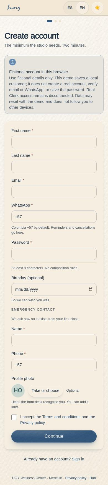
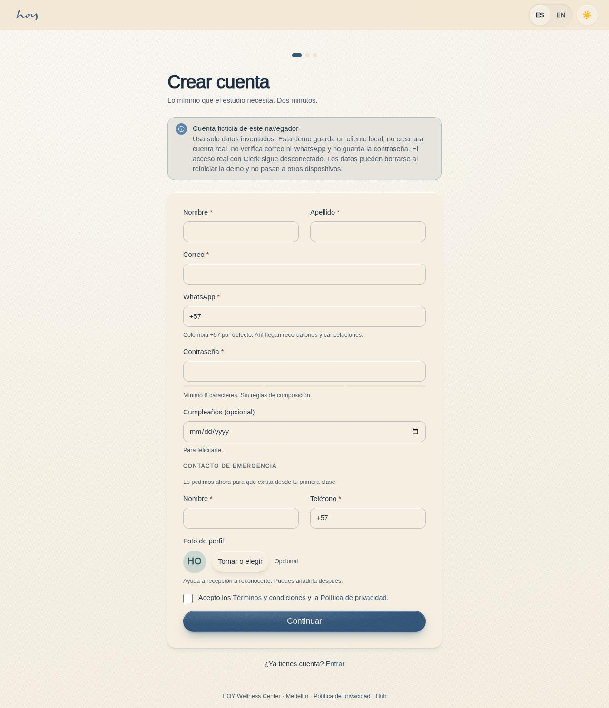
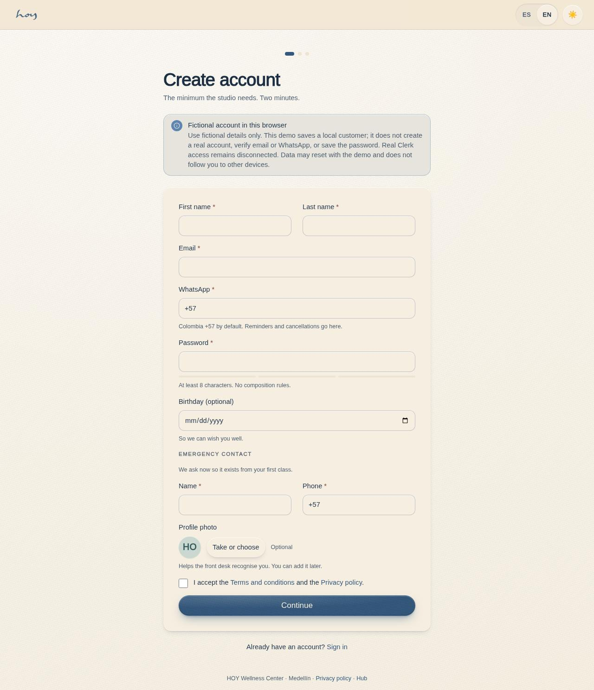

# A-03 — Create account

**Route** `/#/auth/sign-up` · **Roles** public · **Surface** public · **Spec** `spec.code === 'A-03'` (see `/#/dev/specs`)

## Purpose
Collect the minimum the studio actually needs, with WhatsApp as a first-class channel because that is where reminders and cancellations go.

## Screenshots
| ES · mobile | EN · mobile |
| --- | --- |
|  |  |

| ES · desktop | EN · desktop |
| --- | --- |
|  |  |

## Sections (layout order — `useLayout(spec)`)
1. `ProgressDots`
2. `Heading + sub`
3. `FormStack (name, email, WhatsApp +57, password, birthday, emergency contact, photo)`
4. `ConsentRow → /site/legal`
5. `PrimaryButton`

## Responsive layout (0025)
**Shell** `AuthShell` on the shared `TopBar` (wordmark → hub, `LangToggle`, a 44 px theme button), over one centred column: `--w-auth` 480 px below 900 px, `--w-auth-wide` 576 px from 900 px with extra top padding, so the site → sign-in → app hand-off keeps one top bar and no longer narrows to a phone (D-0006).

- After creating the local demo account, a validated website return destination opens; without one, Home (C-01) `/app` opens inside `AppShell` (the A-05 intention step was retired in 0030).

Not captured in the 0025 build (inherits the `AuthShell` change verified on A-02); the matrix pass covers it.
The 1280 captures above predate 0025 and may still show the phone frame; the screenshot pass regenerates them.

## Data
| Table | Read / write | Notes |
| --- | --- | --- |
| `users` | read / write | |
| `profiles` | read / write | |
| `user_roles` | read | |
| `consents` | read / write | |
| `legal_documents` | read | |

## Logic and integrations
- Email and WhatsApp must be unique; duplicates offer sign-in instead.
- Emergency contact is collected here so it exists from the first booking, not only once a waiver is signed.
- Password min 8 chars, strength meter, no composition rules.
- Consent checkbox is required. The current mock stores timestamp, `ip: null` and the existing two document IDs; authoritative consent document versions/IP remain a backend gap.
- Birthday optional — feeds the birthday WhatsApp/email automation.
- Profile photo is optional and offered here, either from the camera or the library, so the front desk can recognise a student on arrival; it can be added later in Settings.
- Colombia default country code +57.
- Integrations remain disconnected: WhatsApp, Email and real account authentication (current Clerk contract).

## States
- default
- validation errors
- duplicate email → sign-in offer
- created

## Real vs mock
- Frontend: the page reads through `useData()` / `useTable`. Browser-only account creation requires `MockProvider.atomic`; a non-mock provider fails closed until an authorized backend registration contract exists.
- Mock / pending: WhatsApp, Email and real Clerk/auth are disconnected; data is the browser-local `MockProvider` seed.
- Note: stages users + profiles + customer-only user_roles + two consents and a digest-only request receipt together; SessionProvider enters the created row only after success while the form remains active. The account may disappear when the demo reseeds. Dynamic-account sign-in on A-02 remains unimplemented.

## Changelog
- `docs/changelog/0005-final-integration.md` — screenshots and this page doc (v0.3.0)
- `docs/changelog/0025-responsive-app-shell.md` — responsive `AppShell` / ≥ 900 px layout (v0.10.0, 2026-09-28)
- `docs/changelog/0030-icons.md` — after creating the account the member lands on Home (C-01); the A-05 intention step is retired (v0.12.0, 2026-09-29)

---
**Resumen (ES).** Crear cuenta. Crear la cuenta con lo mínimo necesario y recoger consentimientos, contacto de emergencia y verificación de WhatsApp.

## 0095 — fictional registration and selected-class return

The current form explicitly accepts fictional data only and creates a local browser demo customer. Real Clerk/auth is disconnected. The existing required fields, locale and two consent document IDs are preserved. Password validation runs in the form; its value never enters the mock command, digest or persistence. A single mock transaction saves user, profile, customer-only role, both consents and a digest-only retry receipt. Failure retries without partial rows; unchanged replay deduplicates and changed replay conflicts. Cancel/unmount prevents late sign-in/navigation. No booking/payment is created by registration.

Validated existing website return destinations survive both auth links and duplicate-account sign-in offers; signup success returns to the selected class/mat instead of always Home. This remains a fixture flow. Authoritative consent versions, real identity/email-code, verified contact and separately signing in as a newly created dynamic demo account remain gaps. See [batch18](../frontend-completion/batch-18.md) for actual checks and release status.
