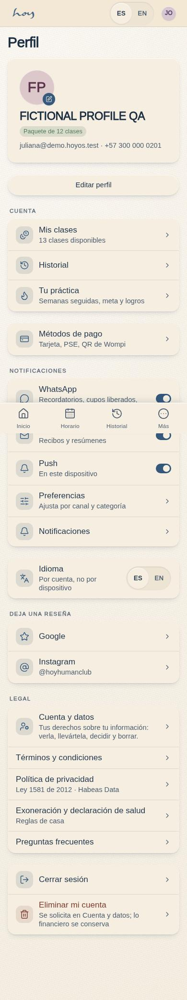
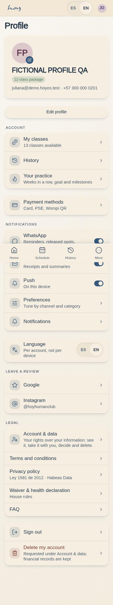
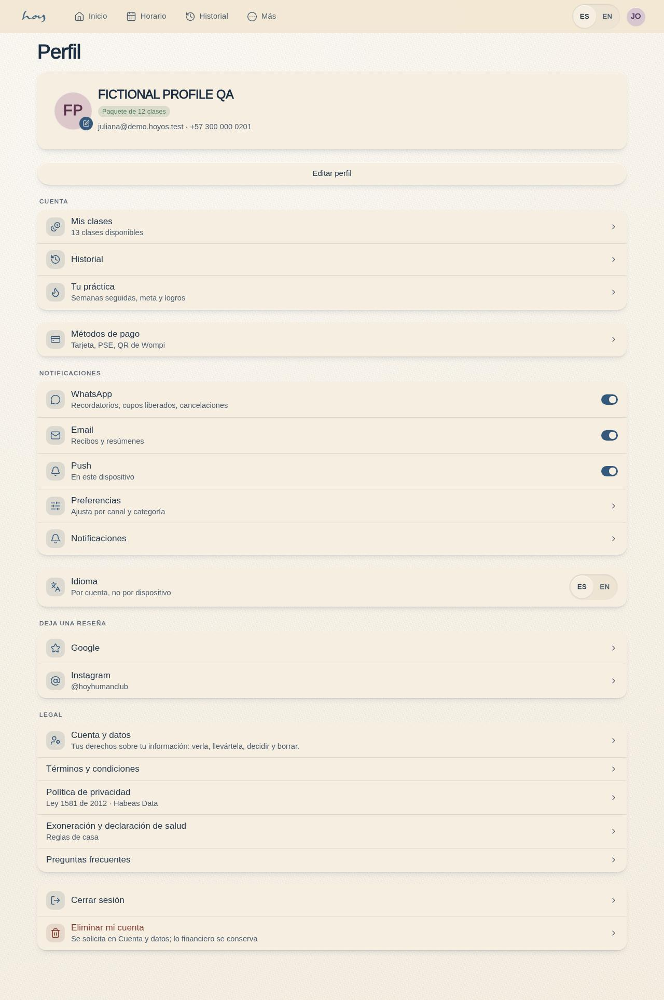
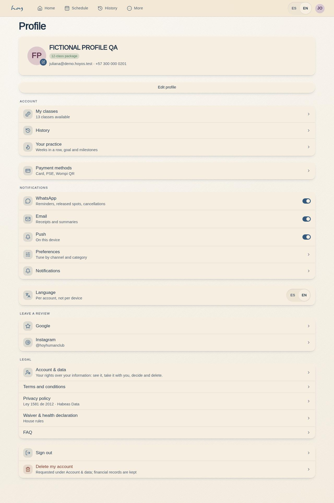

# C-19 — Profile, settings & membership

**Route** `/#/app/profile` · **Roles** customer, teacher (super_admin guard override) · **Surface** customer · **Spec** `spec.code === 'C-19'` (see `/#/dev/specs`)

## Purpose
Everything about me and every switch I own, including where to leave a public review.

## Screenshots
| ES · mobile | EN · mobile |
| --- | --- |
|  |  |

| ES · desktop | EN · desktop |
| --- | --- |
|  |  |

## Sections (layout order — `useLayout(spec)`)
1. `Header (photo, name, membership badge)`
2. `EditProfile`
3. `MembershipRow → plan management`
4. `PaymentMethods`
5. `NotificationPrefs (push / email / WhatsApp)`
6. `LanguageToggle (EN / ES)`
7. `LeaveAReview → Google / Instagram`
8. `Legal links`
9. `SignOut / DeleteAccount`

## Data
| Table | Read / write | Notes |
| --- | --- | --- |
| `profiles` | read / write | |
| `users` | read / write | |
| `memberships` | read / write | |
| `plans` | read | |
| `consents` | read / write | |

## Logic and integrations
- Language switch is instant and per account, not per device.
- Notification preferences are per channel and per event type.
- Account deletion is a request handled in C-26 → M-11 (Ley 1581, fifteen business days); invoices and payment history are kept anonymised, the profile and the access are removed.
- Review links open the studio's Google Business and Instagram.
- Integrations: WhatsApp, Wompi, Email, Supabase Auth, Push notifications

## States
- Loading: header skeleton
- Unverified WhatsApp: verify chip
- Own rows: contained loading, failed/missing read with retry; edit unavailable until both records exist.
- Saving: immediate busy guard; atomic rollback/retry; stale editor conflict; cancellation/context fencing; inline confirmation only after commit.

## Real vs mock
- Rendered: the page uses the data layer. Own-profile editing requires a mock-only atomic command; a real provider must supply an authorized server transaction before this save flow can be connected.
- Mock / pending: WhatsApp, Wompi, Email, Supabase Auth, Push notifications are simulated or deferred; data is the browser-local `MockProvider` seed.
- Note: Language uses the real LangToggle and persists users.locale.
- Note: Notification prefs are per user in localStorage until a notification_prefs table exists.

## 0051 — the studio's verified content (2026-10-01)
The membership row became **Mis clases** → C-07b, with the classes left and a "Congelado" badge while frozen.
| Before (0.21.3) | After (0.22.0) |
| --- | --- |
|  |  |

## Changelog
- `docs/changelog/0051-website-verified-content.md` — the plan row is "Mis clases" with the package and the frozen badge (v0.22.0, 2026-10-01)
- `docs/changelog/0019-app-store-readiness.md` — the delete row now opens C-26 Cuenta y datos (request + retention explanation) instead of disabling the account client-side; new *Cuenta y datos* row under Legal (v0.7.0)
- `docs/changelog/0005-final-integration.md` — screenshots and this page doc (v0.3.0)
- `docs/changelog/0030-icons.md` — icon system: lucide glyphs behind the `Icon` atom (a distinct glyph per profile row (membership, credits, history, payment, notifications, language, reviews, account, sign out, delete)) (v0.12.0, 2026-09-29)

---
**Resumen (ES).** Perfil, ajustes y membresía. Perfil, ajustes, idioma, notificaciones, dispositivos y membresía en un solo lugar.

## 0100 / CU-05 — atomic own-profile save

The existing editable full name, WhatsApp phone, optional birthday and emergency contact save as one browser-mock transaction across the owned profile and user. Name/phone rules remain unchanged; birthday is a valid Gregorian date label with no new age band or cutoff. The command does not change role, email, consent, photo, verification or payment fields. Read failures and missing/ambiguous owned rows never become successful saves. Unchanged retries use one request identity; receipts retain SHA-256 fingerprints and safe IDs/status only. Stale edits require cancel/reopen, preserving the newer values. Cancel/unmount/account-context changes before commit cancel staged work; leaving after a completed commit does not undo that complete browser save or show late success.

The current route grants customer and teacher access, with the existing super_admin override. Other old role descriptions above were stale documentation, not grants. Existing CRM readback covers name, its existing phone projection and birthday; emergency-contact CRM access remains unresolved and was not expanded. Photo persistence and simulated WhatsApp verification are unchanged and unaccepted. Local data is not shared across devices, has no cross-tab transactional guarantee and follows the existing daily fixture reset. CU-05 retains its Nov30 delivery phase and partial acceptance gates.

Evidence: [batch22](../frontend-completion/batch-22.md), `profile-save-results.json` and `profile-save-state-results.json` under screenshots/C-19. Production immutable receipt is recorded in the batch; no real backend/security/storage or public deployment is implied.
