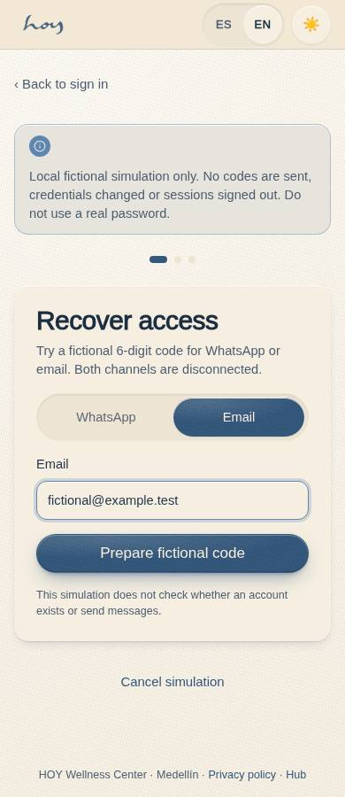
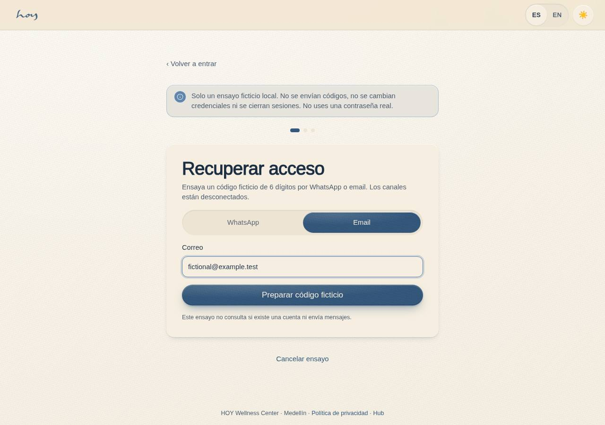
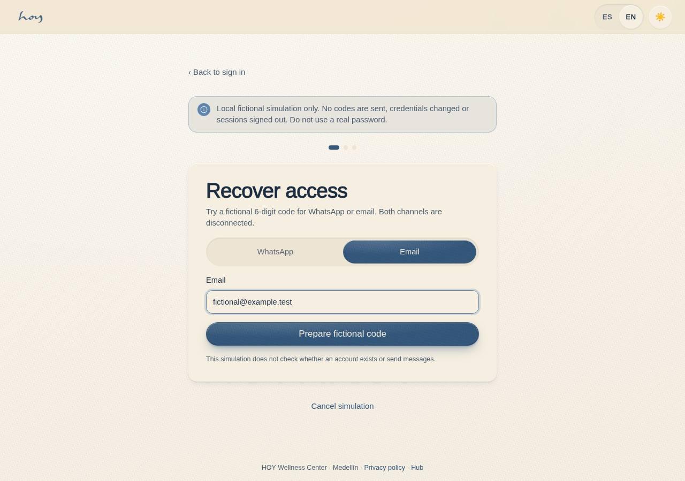

# C-21 — Password recovery (WhatsApp OTP)

**Route** `/#/auth/recover` · **Roles** public · **Surface** public · **Spec** `spec.code === 'C-21'` (see `/#/dev/specs`)

## Purpose
Exercise a fictional, memory-only recovery challenge through the existing email/WhatsApp UI. No message is sent, password changed or session issued/revoked. CU-03/CU-07 remain partial.

## Screenshots
| ES · mobile | EN · mobile |
| --- | --- |
|  |  |

| ES · desktop | EN · desktop |
| --- | --- |
|  |  |

## Sections (layout order — `useLayout(spec)`)
1. `Step1 · Identify (WhatsApp / email)`
2. `Step2 · Verify (OtpInput ×6, ResendTimer)`
3. `Step3 · New password`
4. `BackToSignIn`

## Data and boundaries

No DataProvider tables are read or written. The challenge lives only in component memory; optional session storage holds only the existing resend timestamp. Contact, code and example password are never stored or sent. Screenshots omit active codes and populated passwords.

## Current fictional logic

- Configured six-digit challenge expires at the absolute ten-minute deadline, single use.
- Three wrong attempts invalidate it. Resend revokes the previous challenge immediately and preserves the existing45-second cooldown.
- Busy operation tokens, cancel, fallback and unmount prevent stale preparation/save callbacks. Retry remains available.
- Completion explicitly describes a fictional simulation and disconnected real recovery. Returning to sign-in does not complete account recovery.

## Verification and remaining contracts

[Batch23](../frontend-completion/batch-23.md) records pure, full-build and immutable production EN/ES390/1280 light/dark checks, failure/cancel/retry/replay, zero page errors and unchanged local data/session. Exact-head CI/release receipt is recorded by the coordinator.

Real delivery, account-existence privacy, authenticated challenge verification, provider rate limits, password mutation and session issuance/revocation require Anu's authorized identity contract. Earlier page documentation described five-resends/hour lockout and signing out other devices; those are unimplemented historical descriptions, not a newly approved policy or current behavior. No production auth/security configuration changed.

## Changelog
- `docs/changelog/0005-final-integration.md` — screenshots and this page doc (v0.3.0)

---
**Resumen (ES).** Simulación ficticia de recuperación; no envía códigos, cambia contraseñas ni recupera acceso real.
