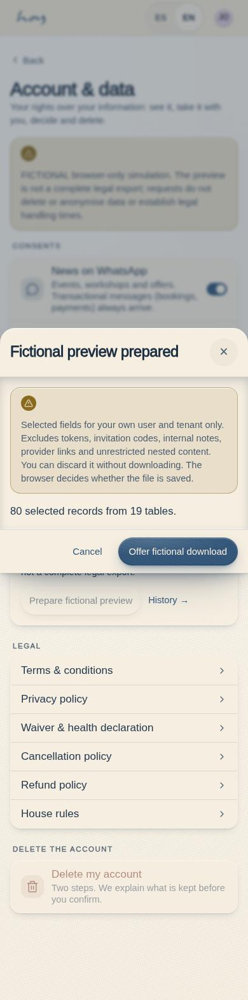
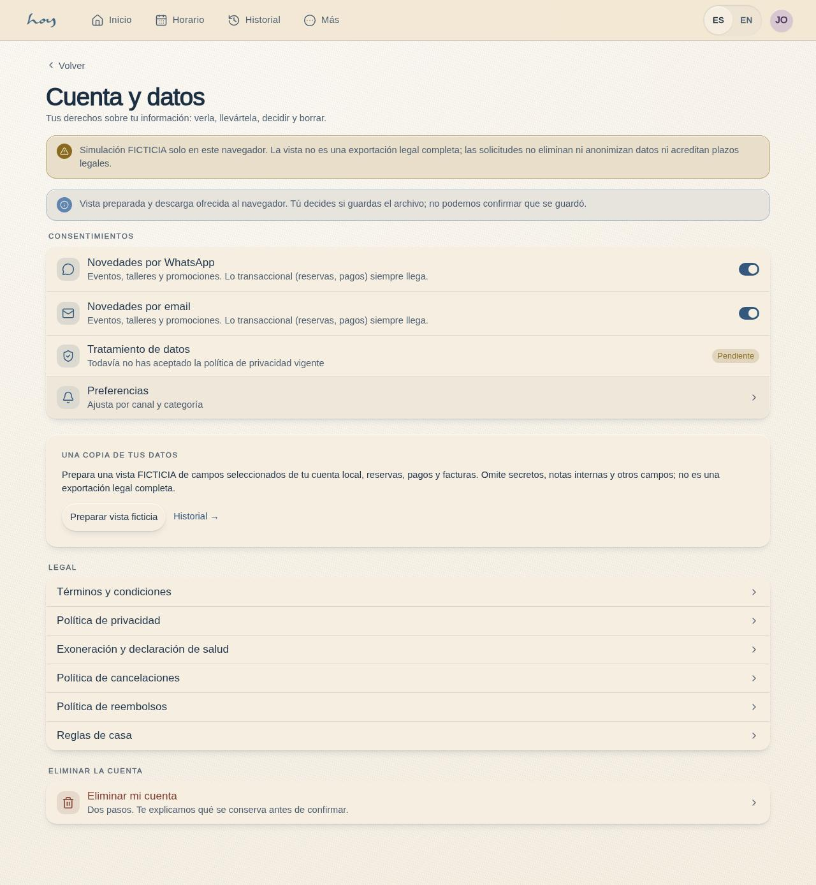
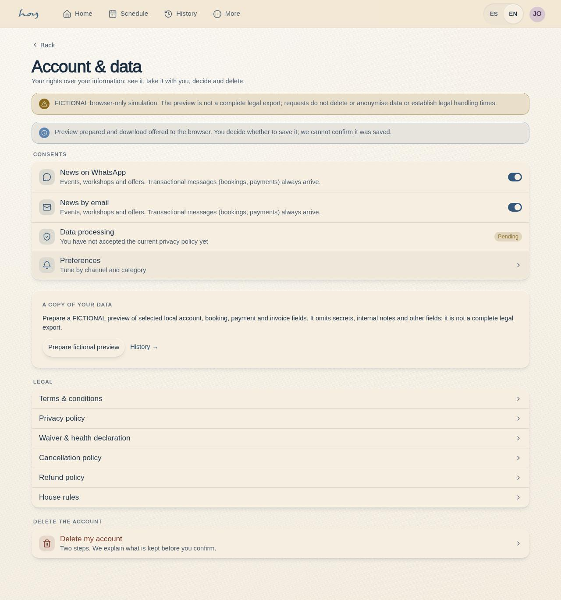
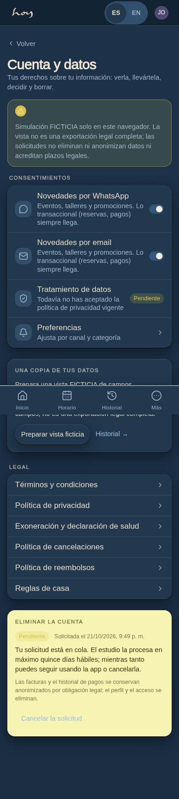

# C-26 — Account & data

**Route** `/#/app/account` · **Roles** customer, teacher · **Surface** customer · **Spec** `src/modules/customer/specs.ts['C-26']` (see `/#/dev/specs`)

## Purpose
Account controls, a fictional preview of selected own data, legal links and a mock deletion request/cancel flow. This screen does not establish legal export completeness, deletion or handling compliance; the full CU-06 criterion remains partial.

## Screenshots
| ES · fictional preview · mobile | EN · fictional preview · mobile |
| --- | --- |
|  |  |

| ES · download offered · desktop | EN · download offered · desktop |
| --- | --- |
|  |  |

| ES · fictional request pending · dark mobile |
| --- |
|  |

## Sections (layout order — `useLayout(spec)`)
1. `ConsentToggles` — marketing by WhatsApp and by email (`notification_prefs` marketing category, mirrored into `profiles.marketing_optin`), the privacy-policy version accepted (`legal_acceptances`) with a link to A-06, and the C-24 matrix.
2. `ExportData` — prepare selected own-user/tenant scalar fields from18 tables plus owned-payment invoices. Confirm or discard the fictional preview; `account.export.prepared` records counts/IDs/digest before a browser download offer.
3. `LegalLinks` — the six A-06 documents.
4. `DeleteAccount` — *Eliminar mi cuenta* (two-step drawer), or, while a request is open, its status card with *Cancelar la solicitud*.

## Data
| Table | Read / write | Notes |
| --- | --- | --- |
| `deletion_requests` | read / write | insert on confirm (`status` requested, `channel` app); update to cancelled |
| `notification_prefs` | read / write | marketing per channel |
| `profiles` | read / write | `marketing_optin` mirror |
| `users` | read | email / phone copied onto the request |
| `legal_acceptances` | read | privacy version accepted |
| `audit_log` | write | `account.deletion_request`, `account.deletion_cancel`, `account.export.prepared`, existing `consent.marketing` |
| `tenants` | read | display name and email through `useSettings()` |
| explicitly allowlisted own-row tables | read | selected scalar preview; excludes tokens/provider refs, unknown/nested fields and internal content |

## Logic and integrations
- Request/cancel and their audit stage atomically in MockProvider. Fresh required owned account/profile rows and request status are checked; requested/processing duplicates are blocked. No account/profile/financial data is removed or changed by these commands. Admin processing and real deletion require a separate backend contract.
- Step one retains the existing explanatory/legal wording behind an explicit fictional boundary and requires the "I understand" switch. Step two records only a mock request. Existing fifteen-business-day wording is unchanged, without a legal interpretation or handling guarantee.
- While a request is `requested` the member can cancel it; once `processing` the card says to write to the studio.
- Integrations: Supabase Auth (deferred) — the deletion job.

## States
- No request: delete row available
- Step 1: explanation, switch off → *Continuar* disabled
- Step 2: fictional request confirm
- Request pending with cancel
- Request processing (no cancel)
- Privacy policy not accepted yet (badge *Pendiente*)
- Reading / read failed / Retry
- Preparing fictional preview / confirm / discard
- Download offered (browser save unknown)
- Mutation failed / Retry / committed replay / cancellation

## Real vs mock
- Browser-local fiction: selected own-data preview and request/cancel metadata persist only in the existing MockProvider. The export body is not stored in audit/receipts. No real provider command, email or deletion is performed.
- Pending: authenticated complete export/correction, server processing/retention/anonymisation, delivery and handling-time contracts. The existing marketing-consent preference/profile/audit multiwrite is outside this batch.

## 0053 — contact card removed
The data-controller contact card was removed at Justin’s request. Consent controls, data export,
the legal library and account deletion remain available. W-14 is no longer a contact handoff.

## Changelog
- `docs/changelog/0047-whatsapp-contact-routing.md` — the data-controller notice shows the `legal` contact, not the front desk (v0.21.0, 2026-09-30)
- `docs/changelog/0019-app-store-readiness.md` — first version (v0.7.0)
- `docs/changelog/0036-real-contact.md` — the data-controller paragraph reads `useContact()`: studio address and WhatsApp added (real since 0036), the email carries “(pendiente)” until M-08a confirms it (v0.13.1)

---
**Resumen (ES).** Cuenta y datos: consentimientos existentes, vista ficticia de campos propios seleccionados, documentos y solicitud/cancelación ficticia en dos pasos. No es una exportación legal completa ni elimina datos; los contratos de servidor, retención y plazos siguen pendientes. CU-06 permanece parcial.

## Batch24 — bounded fictional commands

The local account preview now allowlists selected own-user/tenant scalar fields and owned-payment invoices. It excludes provider tokens/references, unknown/nested data, internal notes, invitee contacts/codes and unrestricted message content. A separate preview confirmation can be discarded without audit/download; offering a file audits prepared counts/IDs/hash only and never claims the browser saved it. A preparation/precommit read failure prevents a partial offer/audit; a postcommit fence failure suppresses the offer without undoing the historical prepared audit. This is not a complete legal export.

Mock deletion request/cancel and audit now stage together with fresh owned required rows/status checks, requested/processing duplicate guard, stable scoped nonce/digest metadata replay, and page-local busy/read/error/retry/cancel/context handling. Reasons are not duplicated in audit. Processing requests cannot be cancelled through stale controls. No account deletion/anonymisation/purge, email, profile or financial effect occurs. Existing fifteen-business-day wording remains unchanged and is not evidence of real handling. Marketing-consent multiwrite and correction/admin/backend work remain separate gaps. [Batch24 proof and limits](../frontend-completion/batch-24.md).

Batch24 replay fence: required owned account/profile shape is re-read before generic receipt replay and after outcomes; request/cancel receipt targets must remain owned. Final in-memory preview consumption revalidates ownership again. Historical metadata replay does not rewrite current status. A failed postcommit fence withholds acknowledgement/download while retaining the committed audit; restoration and retry do not duplicate it. See batch24 replay/domain/UI receipts.

Final repaired proof passed full build, domain6+replay4 groups, complete immutable production matrix and serial dev-state EN/ES checks. [Spanish390 postcommit owned-row failure](../screenshots/C-26/es-390-account-postcommit-ownership-light.jpg) shows the disabled offer; [batch24](../frontend-completion/batch-24.md) records the immutable fingerprint and remaining limits. No production/MVP or commercial acceptance is implied.
