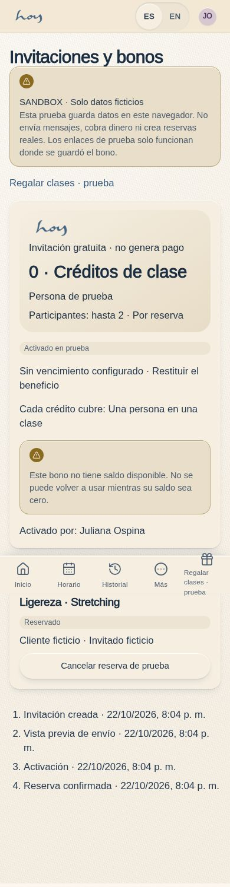
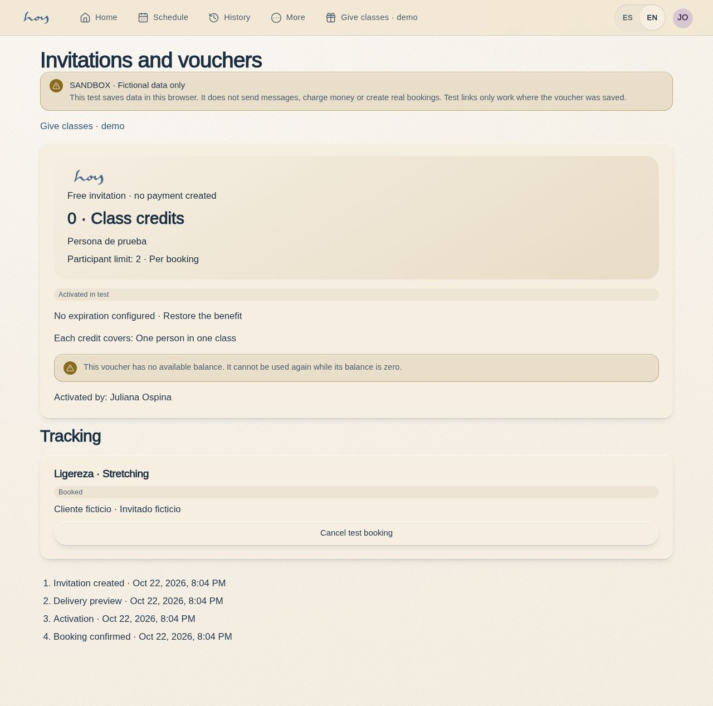

# C-28 · Activate invitation

Routes: `/#/app/vouchers` and `/#/app/vouchers/:id`. The test recipient explicitly activates the invitation with their demo account, selects a scheduled class, supplies fictional participant names, acknowledges guest registration and confirms. Balance and capacity are checked together. A page visit never claims or spends a voucher.

Real shared links require the secure backend described in [backend readiness](../voucher-backend-readiness.md). The current link is browser-local and the interface says so.

## Screenshots

## PL-09 timezone display

[Batch17](../frontend-completion/batch-17.md) covers voucher history and session-option timestamps through the shared Bogotá formatter, preserving persisted instants and voucher terms. [Tokyo-device rendered evidence](../screenshots/C-28/timezone-Asia-Tokyo-en-1280.jpg) is part of the four-zone fictional browser fixture; this does not establish backend or owner acceptance.
