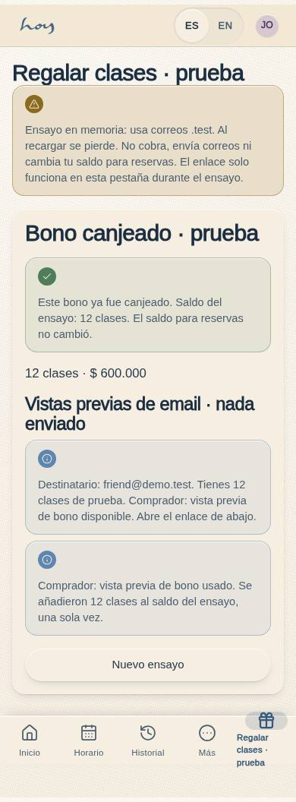
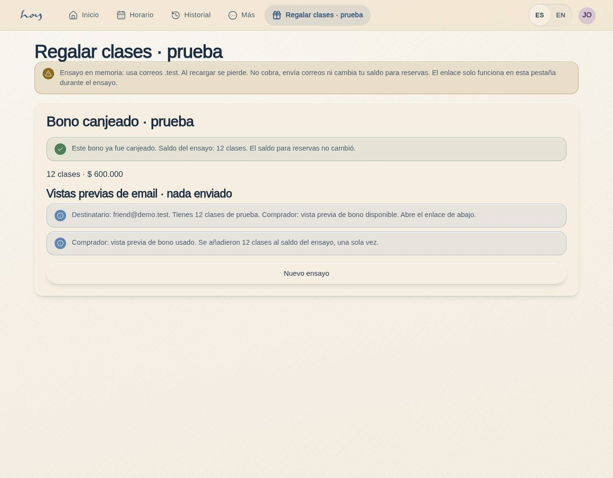
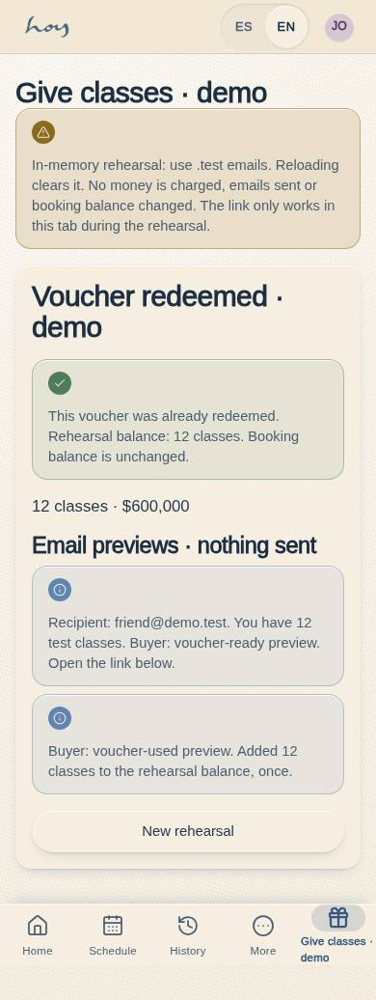
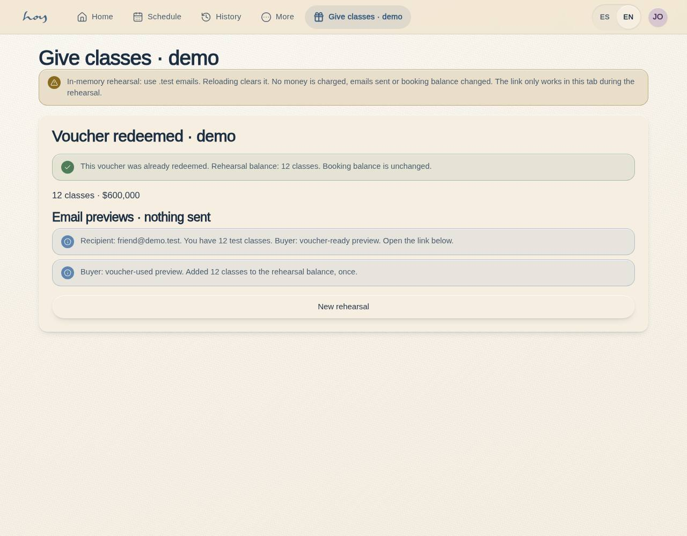

# C-37 · Give classes · demo

Route: `/#/app/voucher-gifts`. Customer, admin and super-admin demo roles. Sections: notice, rehearsal (layout editor supported). Reads `plans` through the provider for reviewed gift quotations. All rehearsal state is component memory, with `.test` addresses only. No provider mutations, payment records, account balance writes or email dispatch. Link navigation preserves state within this page; refresh and other tabs show link-unavailable recovery.

Choose one/twelve classes from existing configured gift products, enter a fictional email, prepare a transfer draft, simulate confirmation, open the recipient link, verify the fictional recipient email, and redeem once. Email previews show ready/used transitions. Booking credits remain unchanged. Production authentication and fulfillment use the [separate integration contract](../frontend-completion/voucher-gifts-integration.md).

