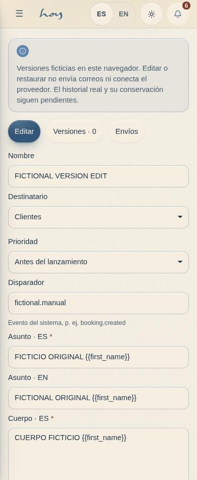
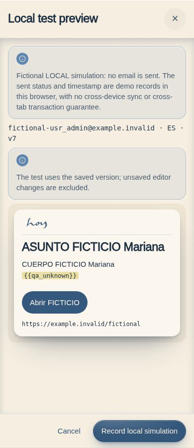
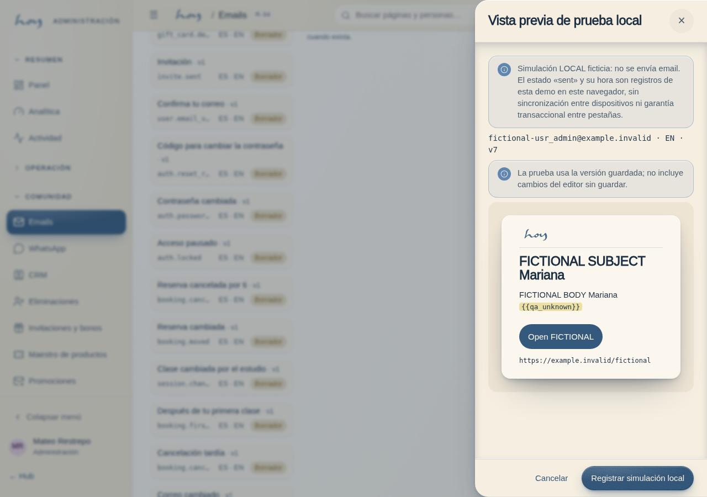
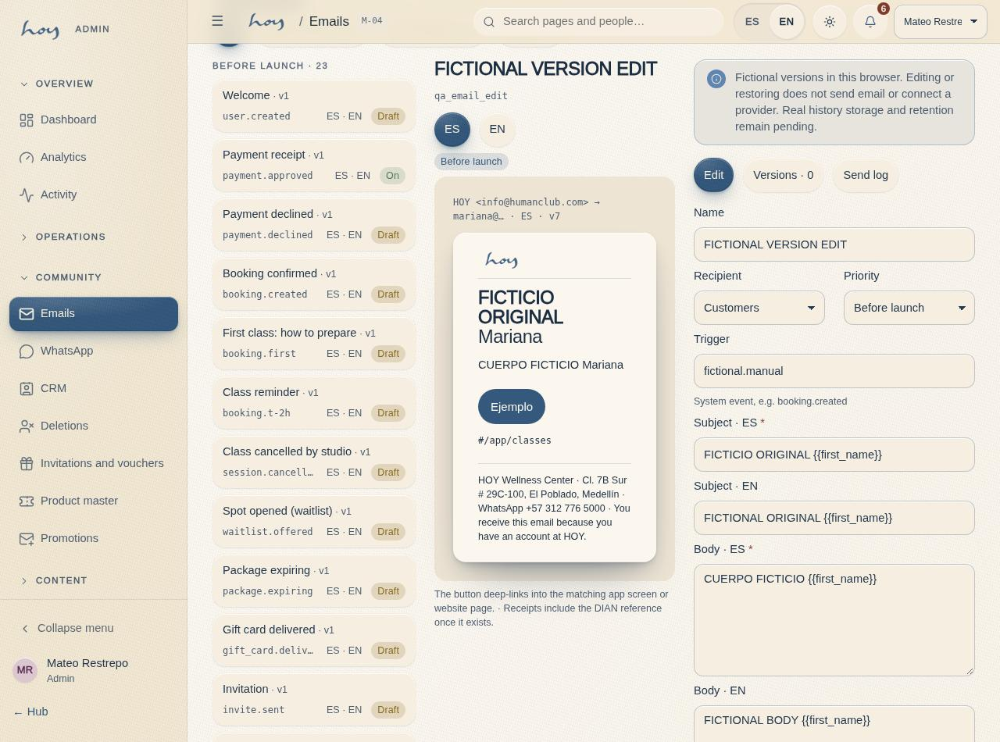

# M-04 — Transactional email designs

**Route** `/#/admin/emails` · **Roles** admin, coordinator, marketing, super_admin · **Surface** admin · **Spec** `spec.code === 'M-04'` (see `/#/dev/specs`)

## Purpose
Every automated email as a real design, editable and previewable, in both languages, with the trigger and the deep link it carries.

## Screenshots
| ES · mobile | EN · mobile |
| --- | --- |
|  |  |

| ES · desktop | EN · desktop |
| --- | --- |
|  |  |

## Sections (layout order — `useLayout(spec)`)
1. `TemplateList (audience → priority, trigger, locale, status)`
2. `Canvas (EmailPreview)`
3. `VariablePanel + Editor`
4. `LocaleSwitch ES / EN`
5. `Versions + TestSend + SendLog`

## Data
| Table | Read / write | Notes |
| --- | --- | --- |
| `email_templates` | read / existing editor write | Self-test freezes saved version; editor writes are outside batch28. |
| `message_log` | read / write | |
| `audit_log` | read / write | One safe `email_template.test` simulation receipt. |
| `users`, `profiles` | scoped read | Current account and referenced log/version names only. |

## Logic and integrations
- Templates: the 95 emails of `src/data/emailCatalog.ts` (0055) — 72 from the inventories, 23 proposed — each with its recipient, priority, trigger, deep link and a note for the admin. Inventory and gaps: `docs/reference/automated-emails.md`.
- Every template deep-links into the matching app screen or website page.
- Receipts include the DIAN electronic invoice reference.
- Version history with rollback remains an existing prototype. The self-test creates one browser-local message row and one audit row atomically; it does not send email.
- Integrations: Wompi, Email, Supabase Auth, Supabase Realtime, DIAN e-invoicing

## States
- Unsaved changes: sticky save bar
- Missing translation: blocked from activation
- Required scoped reads and self-test snapshot: loading, read error and retry.
- Self-test preview: saved version, independent preview locale, own account recipient, busy, cancel, local failure/retry, stale conflict and explicit local completion.

## Real vs mock
The M-04 self-test is explicitly a **browser-local simulation**. No email provider is called. The existing `sent`/`sent_at` fields are retained for compatibility and shown as local simulation, never delivery evidence. Browser persistence can reset and does not promise cross-device persistence or cross-tab transactions. A disconnected or non-atomic adapter is rejected by the simulation command.

The preview freezes the saved template/version, current preview locale and own account email. Unsaved editor changes are excluded and remain intact after the local simulation. It uses the same body/translation fallback and sample-variable render contract as the canvas. Inactive/draft templates remain testable. Users cannot choose another recipient. Only admin, coordinator, marketing and super_admin retain access; no role or permission changed.

Required template/log/version reads are tenant scoped and report errors with retry. User/profile name lookups are limited to referenced actors/recipients and the current actor. A fresh scoped account/template read validates each command. A stable request identity, hashed revision and atomic message-plus-audit commit handle failure/retry/replay; cancel, unmount and selection/actor changes fence pending work. The audit includes safe IDs, version/locale/status and a hash, without recipient/body copies. `payload.test = true` excludes these rows from customer conversations.

The underlying saved body remains JSON `{es,en,cta?}` in `body_mjml`; the MJML designer, real delivery and provider setup remain separate. Existing template save/rollback and generic communication commands retain their prior behavior and are **not accepted by this batch**. No automation, customer send, delivery claim or seamless real-adapter replacement is implemented here.

Batch28 evidence: [batch-28](../frontend-completion/batch-28.md), domain/UI/state result JSON and EN/ES390/1280 light/dark preview/log/role captures under `docs/screenshots/M-04/`.

## 0051 — the studio's verified content (2026-10-01)
The standard set's renewal email became **"Paquete por vencer"** (`package.expiring`: classes left and expiry,
link to Mis clases); the class-cancelled email returns the class to the package.

## 0055 — the automated email inventory (2026-10-03)
Lore's three inventories (website, customer app, teacher app) are in M-04: 72 templates in ES and EN. Tabs by recipient
(Clientes · Profesores · Equipo), a priority filter (Antes del lanzamiento · Primeros 60 días · Después) and the list
grouped by priority. Each email shows when it sends, its priority, whether a screen already promises it, whether it is
marketing (needs opt-in), whether the channel is still email-or-WhatsApp, and what the 2026-10-02 inventory said. The
editor sets recipient and priority (`email_templates.audience`, `priority`). Only the receipt is on.
23 more are **proposed** for the gaps (badge Propuesto). The page opens with "Todos estos emails son sugerencias",
and each email shows a yellow **Nota para el admin** with what to confirm or decide before activating it.

## Changelog
- `docs/changelog/0055-automated-emails-inventory.md` — 95 automated emails (72 inventory + 23 proposed) by recipient and priority, with admin notes (v0.23.0, 2026-10-03)
- `docs/changelog/0051-website-verified-content.md` — "Paquete por vencer" replaces the membership renewal template (v0.22.0, 2026-10-01)
- `docs/changelog/0021-crm-conversacion-y-bandeja.md` — the test send writes the unified `message_log` shape (v0.8.0)
- `docs/changelog/0005-final-integration.md` — screenshots and this page doc (v0.3.0)

---
**Resumen (ES).** Diseños de email transaccional. Diseñar y versionar los emails transaccionales con disparadores y estadísticas.

Batch34 template edit/rollback adds fresh scoped immutable version commands, atomic existing-shaped audit, current-result replay/read acknowledgement and contained cancel/context/read/error/retry states, using existing content.write roles. [Isolated source/build/rendered proof](../frontend-completion/evidence/batch34-source.json), sourcef6edfb6/finalproofaa629da. Real provider delivery, durable version retention and generic comms remain separate; combined exact-head release pending.

Combined operational34–37 current frontend proof: [integration receipt](../frontend-completion/evidence/integrated-batches-34-37.json), frozen0a09975/src0ab95982…, fullbuild/domain/all12 serial rendered gates pass. Final release pending. Local mock only; server authorization/durability, delivery, real financial actions and owner acceptance remain open.
