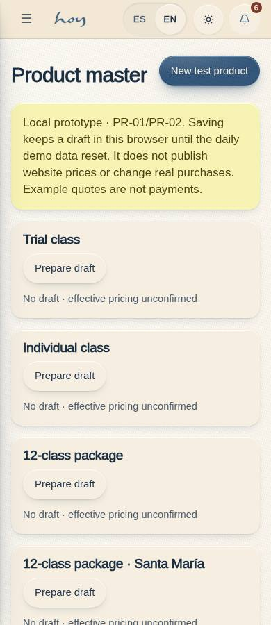
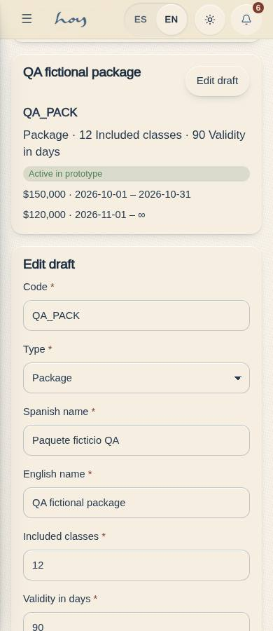
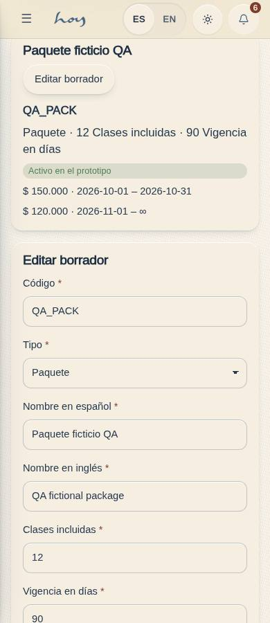
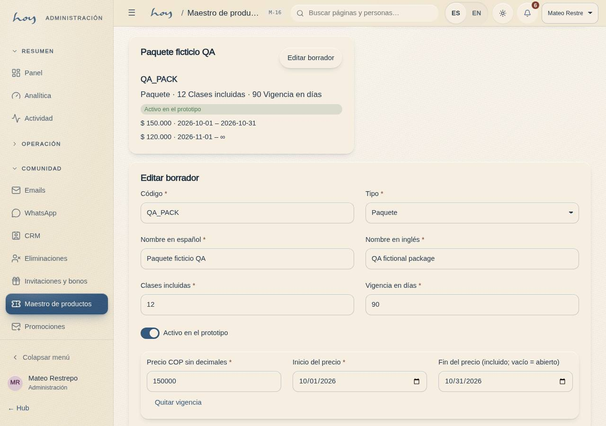
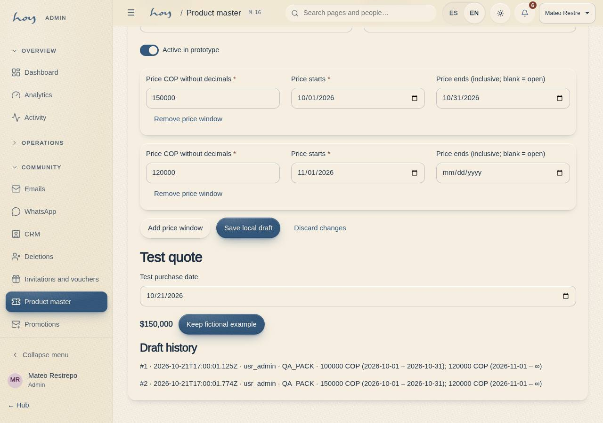

# M-16 — Product master draft / Maestro de productos (borrador)

Route: `/#/admin/products`. Roles: existing admin and super_admin. Source rows: PR-01 / PR-02, MVP Oct 30. Frontend prototype only; operational checkout and public price publication remain disconnected. [Full batch receipt and contract](../frontend-completion/batch-02.md).

The page uses existing Card, Field, Input, Select, Toggle, Badge, Button and EmptyState components. It reads plans through DataProvider, catches read failures and offers retry; edit/cancel is local state until explicitly saving a browser-local draft. All form controls disable while saving. Price windows reject overlap; quote gaps block the example. Existing plan names/prices/statuses remain unchanged. New fake products remain inactive in legacy plan fields.

Fresh state evidence: [loading](../screenshots/M-16/en-390-loading.jpg), [empty](../screenshots/M-16/en-390-empty.jpg), [read error](../screenshots/M-16/en-390-read-error.jpg). Test receipts are adjacent JSON files. Historical/source acceptance and actual deployed release evidence are recorded separately in the completion manifest.
