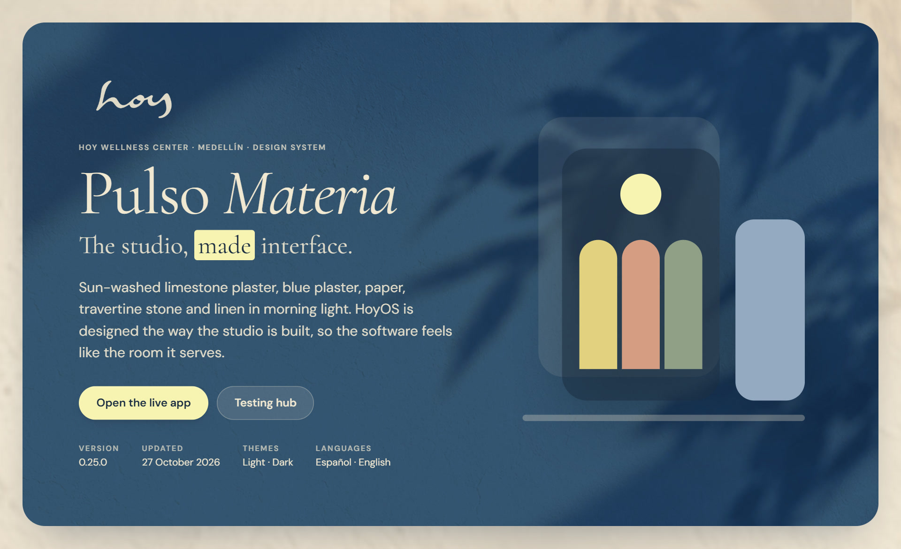
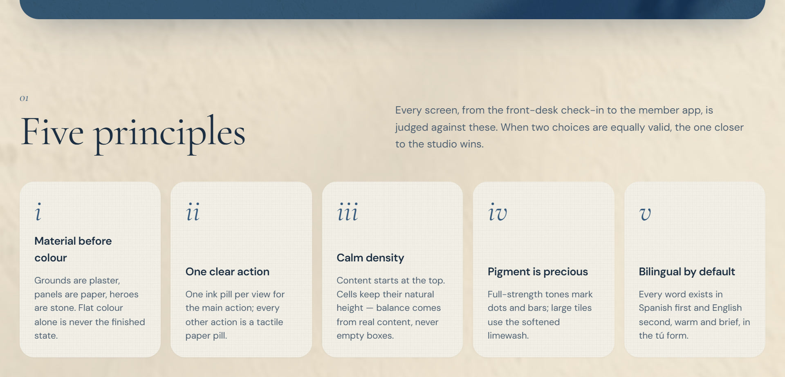
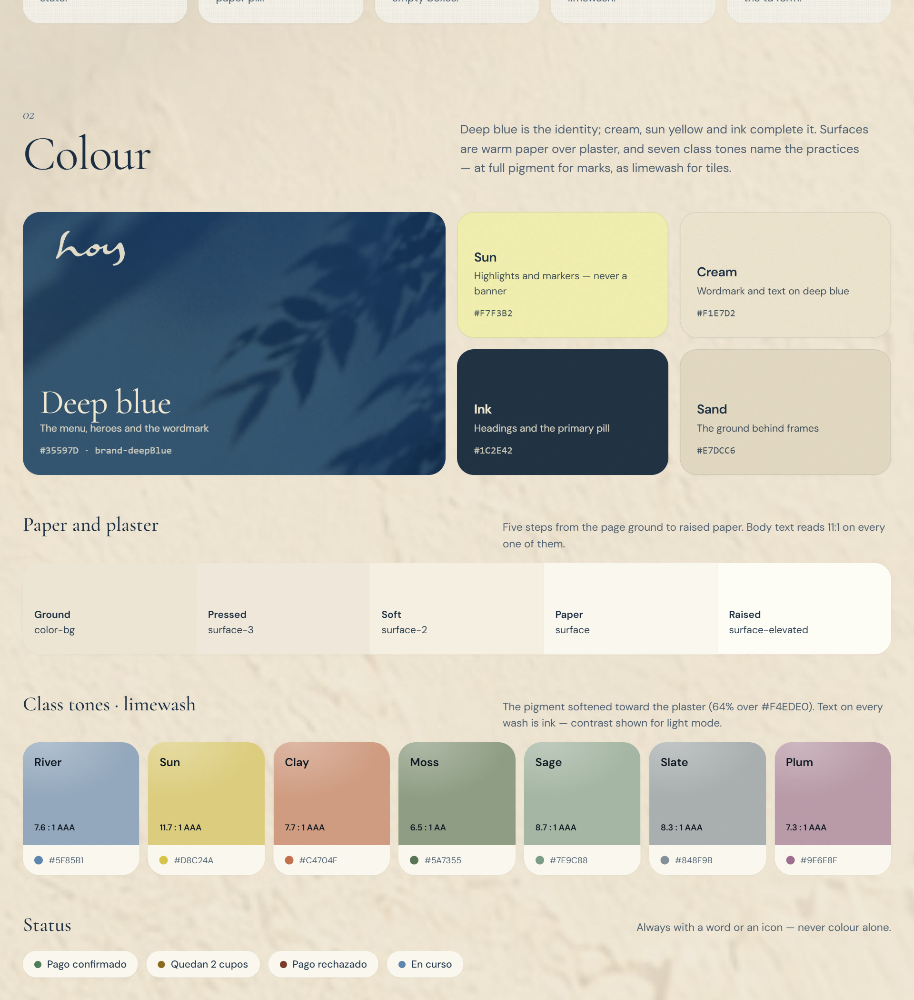
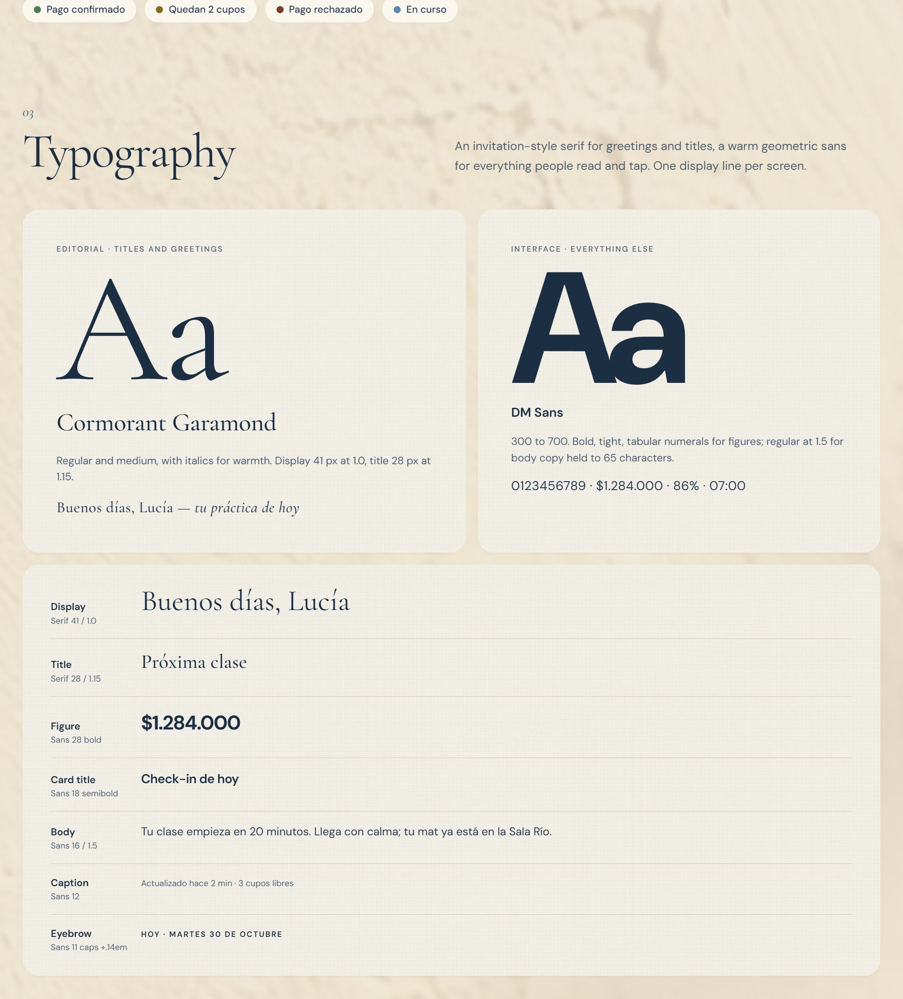
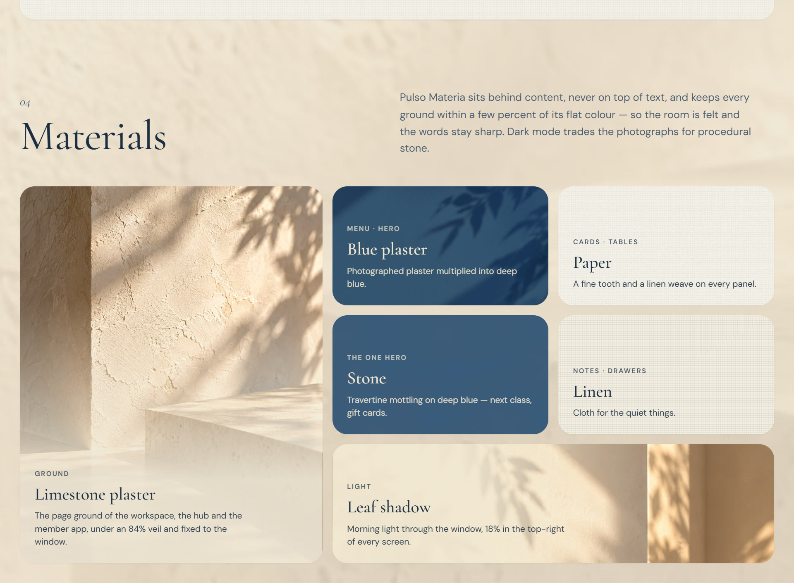
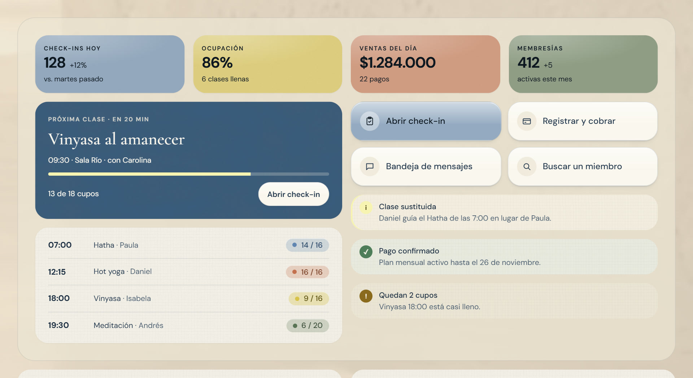
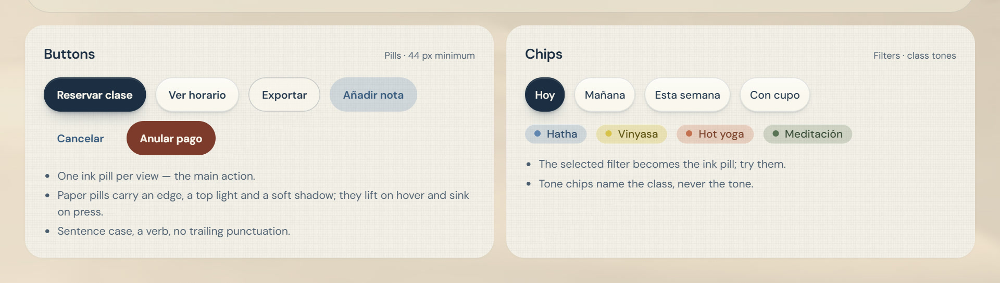
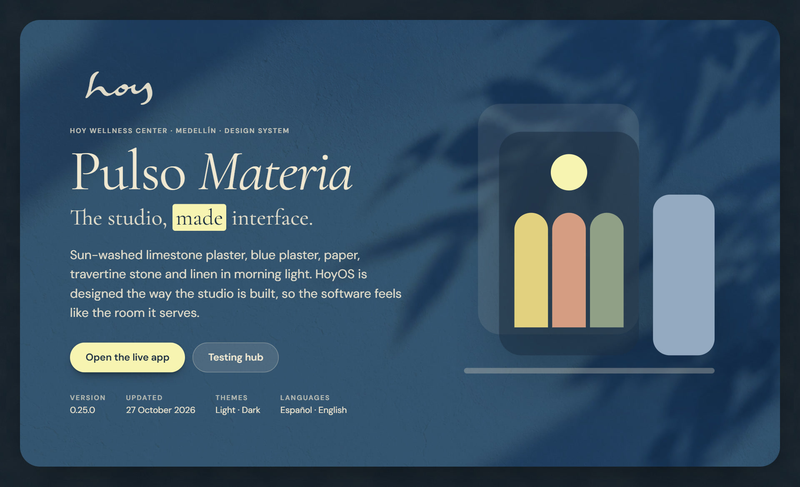
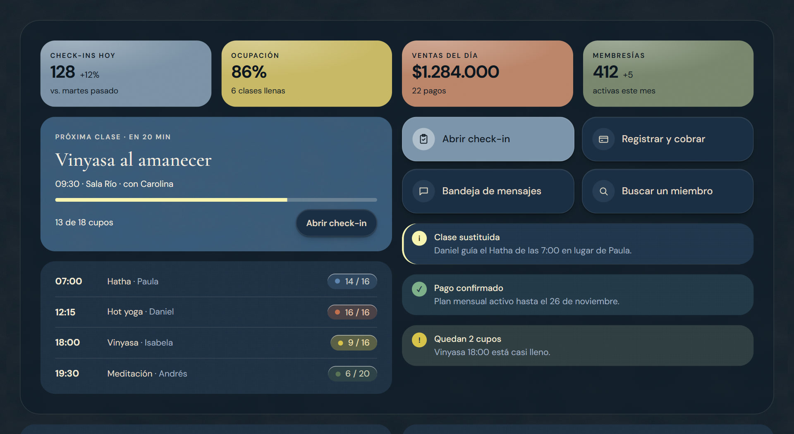
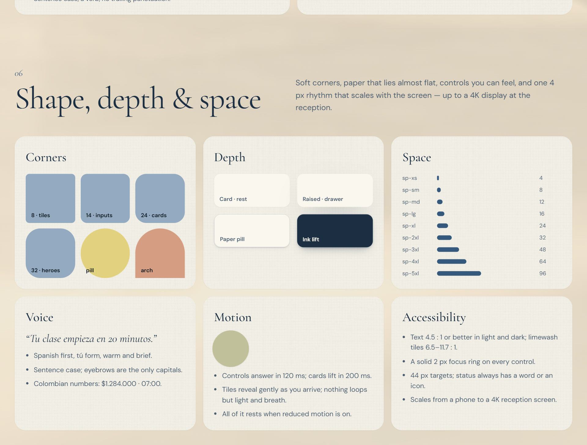

  

<h1 align="center">HOY Design System</h1>

  <i>Pulso Materia — plaster, paper, stone and linen for a wellness studio.</i> 
  HOY Wellness Center · Medellín · v0.25.0 · October 2026

  <a href="https://hoy-human-club.github.io/Hoy-2.0/design-system/"><b>View the design system →</b></a>
  &nbsp;·&nbsp;
  <a href="https://hoy-human-club.github.io/Hoy-2.0/">Live app</a>
  &nbsp;·&nbsp;
  <a href="https://hoy-human-club.github.io/Hoy-2.0/#/hub">Testing hub</a>
  &nbsp;·&nbsp;
  <a href="project/README.md">Brand book</a>
  &nbsp;·&nbsp;
  <a href="project/tokens.json">Tokens</a>

 

> HoyOS is designed the way the studio is built: sun-washed limestone plaster, blue plaster, paper, travertine stone and linen in morning light. The software should feel like the room it serves.

 

## 01 · Principles

**Material before colour** · **One clear action** · **Calm density** · **Pigment is precious** · **Bilingual by default**

 

## 02 · Colour

Deep blue `#35597D` is the identity, with cream, sun yellow and ink. Surfaces are warm paper over plaster. Seven class tones name the practices: full pigment for dots and bars, softened limewash for tiles, with ink text at 6.5–11.7 : 1.

 

## 03 · Typography

**Cormorant Garamond** is used for greetings and titles. **DM Sans** is used for everything people read and tap. There is one display line per screen.

 

## 04 · Materials

Materials sit behind content, never on top of text. Each ground stays within a few percent of its flat colour, so contrast is unchanged. Dark mode replaces the photographs with procedural stone.

 

## 05 · Components

Limewash KPI tiles, the stone hero, paper lists, tactile quick actions and linen notes. Buttons and chips are pills at least 44 px tall: one ink pill per view, paper pills for everything else.

<b>Dark mode</b>

 

 

## 06 · Shape, depth & space

Soft corners (24 px cards, 32 px heroes, pills for controls) and paper that lies almost flat. Controls have a tactile feel, and one 4 px spacing rhythm scales from a phone to a 4K reception screen.

 

---

### What's in this folder

| | |
|---|---|
| [**Design system page**](https://hoy-human-club.github.io/Hoy-2.0/design-system/) | The presentation: an interactive page with a light/dark switch (source: [`public/design-system/index.html`](../../../public/design-system/index.html)) |
| [`project/README.md`](project/README.md) | The brand book: principles, voice, colour, type, materials, depth, spacing, motion, accessibility, icons, logo |
| [`project/tokens.json`](project/tokens.json) | Colour (light + dark), type, spacing, radius, shadow and motion tokens, each with a usage note |
| [`project/components/`](project/components/) | Button, Chip, Card, StatTile, Notice and Materials guidelines and previews |
| [`screens/`](screens/) | Every component preview rendered in light and dark |

The source of truth is the code: <code>src/design/tokens.ts</code> (D-01) and <code>src/styles/materials.css</code>. This folder is a snapshot of those values. All demo content is fictional.
