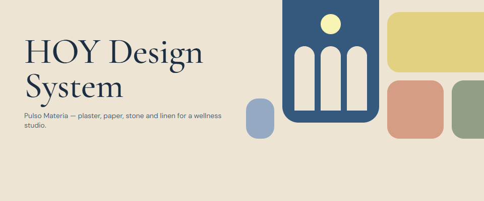
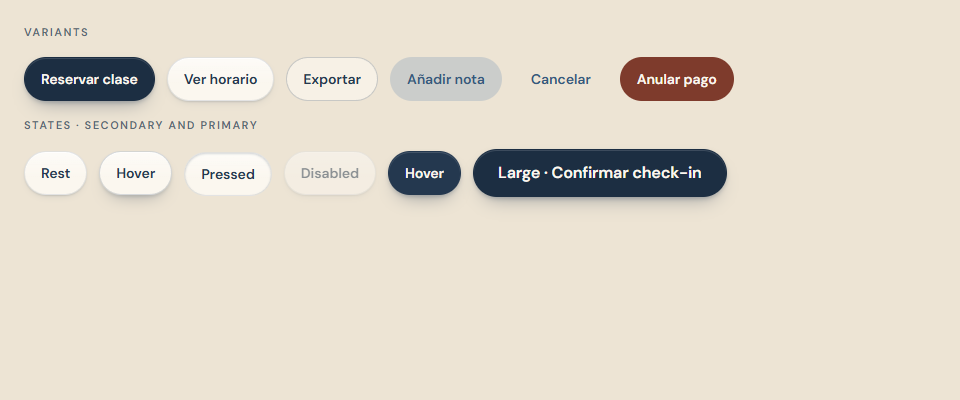
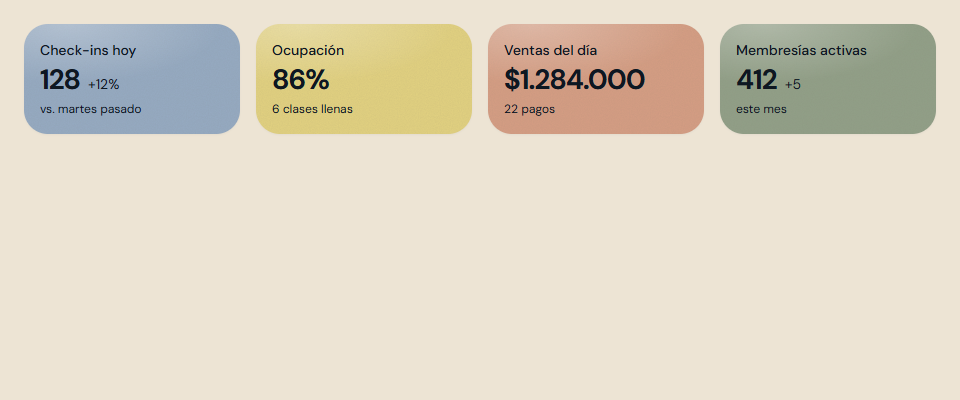
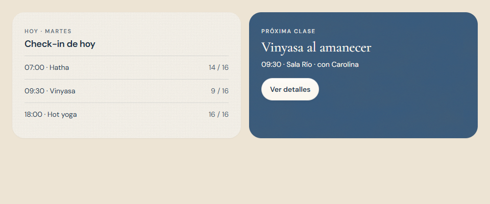
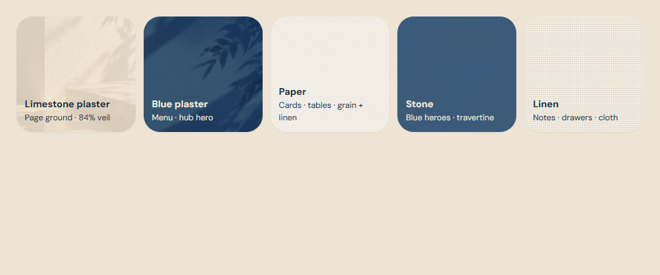
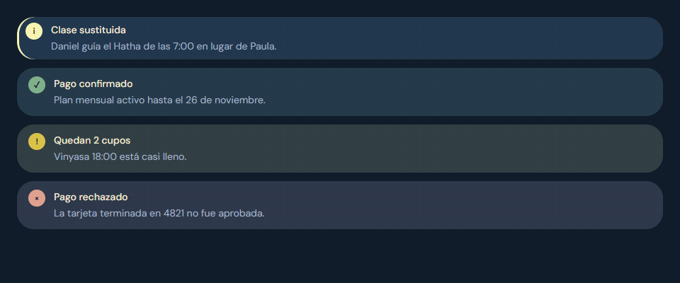

# HOY Design System — client edition

The HoyOS design system as sent to the client: the Pulso Materia brand book, the tokens (light and dark), the core components with usage rules, and the logo and material assets.

- **Interactive version:** https://claude.ai/artifact/B9jAL3bAv4cvVqyDH3r7YN (shared from the artifact's Share menu)
- **Live app it describes:** https://hoy-human-club.github.io/Hoy-2.0/ (v0.25.0, changelog 0171)
- **Source of truth:** `src/design/tokens.ts` (D-01) and `src/styles/materials.css`. This folder is a snapshot of those values, not a second source.

## Contents

| Path | What |
|---|---|
| [project/README.md](project/README.md) | Brand book: principles, voice, colour, type, materials, depth, spacing, motion, accessibility, icons, logo |
| [project/tokens.json](project/tokens.json) | Colour (light + dark), type, spacing, radius, shadow and motion tokens with usage notes |
| [project/components/](project/components/) | Button, Chip, Card, StatTile, Notice and Materials: a static preview and guidelines each, plus the cover |
| [project/components/bundle.css](project/components/bundle.css) | The stylesheet the previews share |
| [project/assets/](project/assets/) | Usage notes for the logos and the material photographs (the images are `public/brand` and `public/images/sanctuary`) |
| [screens/](screens/) | Every preview rendered in light and dark |

## Preview

